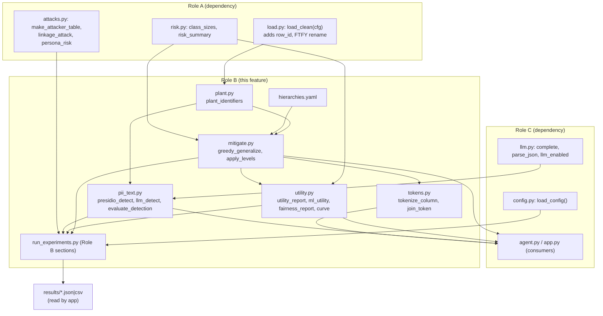
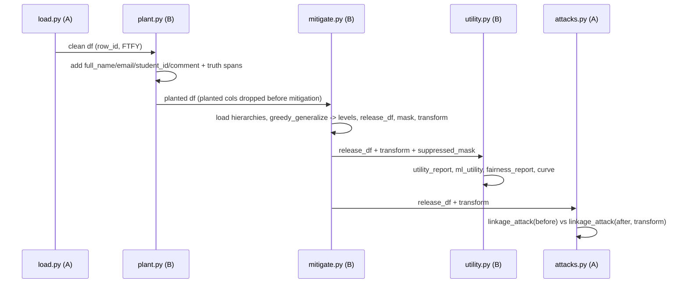

# Design Document: role-b-mitigation

## Overview

Role B of the *Unmasked: Re-identification Risk Meter* project owns the data-mitigation
half of the privacy pipeline: generalization hierarchies, a greedy k-anonymity optimizer,
a reversible tokenization vault, planted synthetic PII with ground truth, PII detection
(Presidio + optional LLM), and the utility / fairness evaluation that quantifies what the
privacy fix costs — including which demographic groups pay the most for it.

This feature recreates **exactly seven deliverables and nothing else**: `hierarchies.yaml`,
`reid/plant.py`, `reid/pii_text.py`, `reid/tokens.py`, `reid/mitigate.py`, `reid/utility.py`,
and the Role B sections of `scripts/run_experiments.py`. All other modules (`config.py`,
`load.py`, `risk.py`, `attacks.py`, `llm.py`, `classify.py`, `agent.py`, `app.py`) are owned
by Roles A and C and are consumed as external interfaces. The reference implementation in
Appendix B of `docs/role-B-mitigation-tokens-evaluation.md` is the authoritative design: the
Low-Level Design below embeds that code structure verbatim. The task is to reproduce working
code in Kiro, run it, and check the output against the acceptance numbers — not to invent
alternatives.

The language is Python 3.11+ with pandas, as used throughout the reference. Code examples use
Python syntax because the reference implementation is Python.

---

## Architecture

Role B sits in the middle of the end-to-end pipeline. Role A loads and risk-scores the data;
Role B plants PII, tokenizes, mitigates, and evaluates; Role C's agent and Streamlit app drive
and display it.



### Pipeline data flow



### External interfaces consumed (owned by other roles — do not design or modify)

| Module | Function(s) used by Role B | Contract |
|---|---|---|
| `reid/config.py` (C) | `load_config(path="config.yaml") -> dict` | returns the canonical config dict (roles, targets, personas, utility_analyses) |
| `reid/load.py` (A) | `load_raw(cfg)`, `load_clean(cfg) -> DataFrame` | clean df with `row_id` first column, `First Time First Year` renamed to `FTFY`, `MAJsecond` cast to str, `logdate` as datetime |
| `reid/risk.py` (A) | `class_sizes(df, qis) -> Series`, `risk_summary(df, qis, k) -> dict` | `class_sizes` aligned to `df.index`, groupby `dropna=False`; `risk_summary` ignores qis not in `df.columns` |
| `reid/attacks.py` (A) | `make_attacker_table(df, known_cols, n, seed)`, `linkage_attack(release_df, attacker_df, known_cols, transform=None)`, `persona_risk(df, personas, k)` | linkage `transform` applies the release generalization to the attacker's raw knowledge |
| `reid/llm.py` (C) | `complete(prompt, system, json_mode, max_tokens)`, `parse_json(text)`, `llm_enabled()` | `complete` returns `None` on error/disabled; `llm_detect` returns `[]` when disabled |
| `config.yaml` | roles, targets (k=5, max_suppression=0.05, max_group_suppression=0.10), personas, utility_analyses | canonical content in section 7 of the brief |

### Data conventions (all Role B code must respect)

- Every DataFrame carries a `row_id` column (int, `0..n-1`, original order), added by `load.py`.
  It is **never** part of a released/exported file; `release_df` keeps it only so experiments
  and `utility_report` / `ml_utility` can join on identity.
- All group-bys use `dropna=False`; missing values are their own group.
- `-9` is a **valid category** (e.g. "no second major"), never treated as missing.
- `MAJsecond` is a string; numeric code columns keep `-9` as a real value.
- `pd.cut` labels must be strings; NaN is restored after binning.
- `keys/` and `data/` are never committed; the vault key is stored separately from the release.
- Tokenized data is pseudonymous, not anonymous.
- Never send row-level student data to an LLM. The only exception: planted **synthetic**
  comments may be sent to `llm_detect` for the detection comparison.

---

## Components and Interfaces

### Component 1: `hierarchies.yaml` — generalization hierarchies

**Purpose**: Declarative generalization levels for every quasi-identifier and metadata column.
Level 0 is identity (original values); the last level of every column is always `drop`. A
`derived:` section lists derived major columns that must be removed in lockstep when their
source code column reaches a given level, so detail cannot leak back.

**Rule types**: `identity`, `map`, `map_other`, `from_column`, `has_value`, `month`, `year`,
`bins`, `drop`.

**Responsibilities**:
- Define a monotone coarsening ladder per column (each step removes detail).
- Keep derived columns consistent with their source (`derived:` section).
- Avoid PyYAML pitfalls: use `label_yes`/`label_no` (not `yes`/`no`, which parse as booleans);
  use a plain integer `1000000000` (not `1.0e12`, which parses as a string).

### Component 2: `reid/plant.py` — planted identifiers + ground truth

**Interface**:
```python
plant_identifiers(df, seed=42, pct_pii=0.30, pct_decoy=0.10) -> (planted_df, truth_df)
```
**Responsibilities**:
- Add `full_name`, `email` (first-initial + last-name + number `@bu.edu`),
  `student_id` (`"U"` + 8 digits), and `comment`.
- ~30% of comments contain PII from templates (names, emails, 617 phone numbers, BU IDs,
  sometimes two entities), ~10% are decoys (look like PII but are not), ~60% are clean.
- Emit a truth table with exact character spans.

**Invariant**: for every truth row, `comment[start:end] == value` (0 span errors).
`truth_df` columns: `row_id, entity_type, value, start, end` where
`entity_type ∈ {PERSON, EMAIL_ADDRESS, PHONE_NUMBER, BU_ID}`.

### Component 3: `reid/pii_text.py` — PII detection, scrubbing, scoring

**Interface**:
```python
ENTITIES = ["PERSON", "EMAIL_ADDRESS", "PHONE_NUMBER", "BU_ID"]
presidio_detect(text, threshold=0.4) -> list[{entity_type, start, end, score}]
llm_detect(text) -> list[span]          # [] if LLM disabled
combine(a, b) -> list[span]             # merged, de-overlapped
scrub_text(text, method="presidio", spans=None) -> str
evaluate_detection(truth_df, predictions: {row_id: spans}) -> DataFrame
```
**Responsibilities**:
- `presidio_detect`: small spaCy model `en_core_web_sm` + a custom `BU_ID` regex recognizer
  (`\bU\d{8}\b`, score 0.9); return only the four entity types.
- `llm_detect`: only if C's LLM is enabled; asks for `{entity_type, text}` pairs and maps them
  to spans with `str.find`. Send only synthetic comments.
- `combine`: union then de-overlap (highest score wins).
- `scrub_text`: replace each span with `<ENTITY_TYPE>`.
- `evaluate_detection`: a true positive needs the same entity type and overlapping spans; each
  truth entity is matched at most once. Only rows present in `predictions` are scored. Output
  rows per entity type plus an `ALL` row, with `tp, fp, fn, precision, recall, f1`.

### Component 4: `reid/tokens.py` — reversible tokenization vault

**Interface**:
```python
ensure_keys(keys_dir="keys")
join_token(value) -> str                         # HMAC-SHA256 hex[:16]
tokenize_column(df, col, vault_path=None) -> DataFrame
detokenize(token, col, vault_path=None) -> str
```
**Responsibilities**:
- `ensure_keys`: create `keys/vault.key` (Fernet) and `keys/join.key` (unless `JOIN_KEY` env set).
- `join_token`: deterministic HMAC-SHA256 with the join key, hex, first 16 chars — so tokenized
  datasets can still be joined.
- `tokenize_column`: replace `col` with tokens; write a per-column vault
  `keys/vault_<col>.csv` with columns `token, encrypted_value` (Fernet-encrypted original).
- `detokenize`: reverse a token via the vault + vault key.

**Acceptance**: `detokenize(tokenize_column(df, "student_id").student_id[0], "student_id")`
returns the original; nothing in `keys/` is committed.

### Component 5: `reid/mitigate.py` — hierarchies + greedy generalization

**Interface**:
```python
load_hierarchies(path="hierarchies.yaml") -> dict
max_level(col) -> int                            # index of the last (drop) level
apply_levels(df, levels: {col: int}) -> DataFrame
make_transform(levels) -> callable               # df -> df
suppress(df, qis, k) -> (kept_df, suppressed_mask)
greedy_generalize(df, qis, k=5, max_suppression=0.05, max_group_suppression=None,
                  group_col="affiliation", protect=(), must_keep=()) -> dict
```
**Responsibilities**:
- `apply_levels`: return a generalized copy; drop columns at their `drop` level; drop derived
  columns in lockstep; skip columns not present (attacker tables carry only a few columns).
- `greedy_generalize`: at each step, try one more level on every non-protected column; score by
  gain-per-cost (dropping a column costs 2, coarsening costs 1); stop when overall below-k ≤
  `max_suppression` and (if set) every group's below-k ≤ `max_group_suppression`; then suppress
  the remainder. `must_keep` columns are capped at level 1.
- Return dict keys: `levels, release_df (row_id kept), suppressed_mask (aligned to input index),
  steps, final_risk, active_qis, transform`.

### Component 6: `reid/utility.py` — utility, fairness, curve

**Interface**:
```python
group_means(df, scales, by) -> DataFrame
utility_report(original_df, release_df, scales, by_list, levels=None) -> dict
ml_utility(original_df, release_df, transform, target="SE", exclude=(), seed=42) -> dict
fairness_report(df, suppressed_mask, group_col="affiliation") -> DataFrame
privacy_utility_curve(df, qis, scales, by_list, ks=(2,3,5,10), **greedy_kwargs) -> DataFrame
```
**Responsibilities**:
- `utility_report`: compare group means on original vs. the kept rows; group labels come from
  the **original** data joined on `row_id`, so shifts measure suppression distortion.
  `analysis_status[by] ∈ {available, coarsened, lost}`.
- `ml_utility`: `HistGradientBoostingRegressor` predicting `SE`, excluding `SE*` items, IDs,
  metadata, and planted columns; train on original vs. released rows, test both on the same
  held-out **original** rows (generalized with `transform` for the release model).
- `fairness_report`: share of each group's records removed.
- `privacy_utility_curve`: run the optimizer at k = 2, 3, 5, 10.

### Component 7: `scripts/run_experiments.py` — Role B sections

**Purpose**: Write the small result files read by the app and used in the pitch. The Role A
section (baseline risk, combos, leaks, personas, risk_by_group, l_diversity, staircase) already
exists and is **not** part of this feature. Role B adds:
- mitigation in both modes (`protect_on` with `protect=[affiliation]` and
  `max_group_suppression`; `protect_off` with `{}`), writing `results/attack.json`,
  `results/fairness.csv`, `results/mitigation_summary.json`, `results/curve.csv`;
- PII detection writing `results/detection.csv` with methods `presidio`,
  `presidio_same_sample`, `llm`, `combined`, gated behind `--skip-presidio`.

---

## Data Models

### Planted columns (added to the clean df)

| Column | Type | Example | Notes |
|---|---|---|---|
| `full_name` | str | `Maria Lopez` | Faker-generated |
| `email` | str | `mlopez42@bu.edu` | first-initial + last-name + 1–99 |
| `student_id` | str | `U48102337` | `"U"` + 8 digits |
| `comment` | str | free text | ~30% PII, ~10% decoy, ~60% clean |

### `truth_df`

| Column | Type | Notes |
|---|---|---|
| `row_id` | int | joins to the planted df |
| `entity_type` | str | `PERSON \| EMAIL_ADDRESS \| PHONE_NUMBER \| BU_ID` |
| `value` | str | exact substring |
| `start` | int | inclusive char offset into `comment` |
| `end` | int | exclusive char offset; `comment[start:end] == value` |

### Detection span

```python
{"entity_type": str, "start": int, "end": int, "score": float}
```

### Vault file `keys/vault_<col>.csv`

| Column | Notes |
|---|---|
| `token` | HMAC-SHA256 hex[:16] (deterministic) |
| `encrypted_value` | Fernet ciphertext of the original (randomized) |

### `results/` files written by Role B

| File | Content |
|---|---|
| `attack.json` | `{mode: {persona: {before, after}}}`, mode ∈ `protect_on`, `protect_off` |
| `fairness.csv` | `fairness_report` + `setting` column (`protect_on` / `protect_off`) |
| `mitigation_summary.json` | per mode: levels, pct_suppressed, final_risk, shifts, analysis_status, ml |
| `curve.csv` | `privacy_utility_curve` (protect off) |
| `detection.csv` | `evaluate_detection` + `method` (`presidio`, `presidio_same_sample`, `llm`, `combined`) |

---

## Correctness Properties

### Property 1: Span integrity (plant)

For every row `r` in `truth_df`, `planted_df.loc[r.row_id, "comment"][r.start:r.end] == r.value`
(0 span errors), because spans are computed from `len(text)` as the comment is built.

**Validates: Requirements 1.6**

### Property 2: Token determinism

`join_token(v)` is a pure function of `(JOIN_KEY, v)`; equal inputs yield equal tokens across
datasets, so tokenized datasets can still be joined.

**Validates: Requirements 4.3, 4.4**

### Property 3: Reversibility

For any row `i`, `detokenize(tokenize_column(df, col).iloc[i][col], col) == str(df.iloc[i][col])`.

**Validates: Requirements 4.6**

### Property 4: Monotone generalization

Increasing a column's level never increases that column's distinct-value count, and reaching
`max_level(col)` removes the column from the output.

**Validates: Requirements 3.2, 3.5**

### Property 5: Lockstep derived drop

When a source code column reaches the level listed in the `derived:` section, its derived columns
are absent from `apply_levels` output.

**Validates: Requirements 3.3**

### Property 6: Suppression completeness

After `suppress(df, qis, k)`, every equivalence class in `kept_df` has size ≥ k over the `qis`
present in the frame.

**Validates: Requirements 3.6**

### Property 7: Detection scoring

A prediction is a true positive iff an unmatched truth entity shares its entity type and overlaps
its span; each truth entity matches at most one prediction, and only rows present in `predictions`
are scored.

**Validates: Requirements 5.8**

---

## Error Handling

| Scenario | Condition | Response |
|---|---|---|
| Optimizer cannot meet target | all columns exhausted before below-k ≤ target | `greedy_generalize` stops and suppresses the remainder; `steps`/`final_risk` report the shortfall |
| Column absent from frame | attacker tables carry only a few columns | `apply_levels` and `suppress` skip columns not in `df.columns`; `risk_summary` ignores missing qis |
| LLM disabled or errors | `llm.complete` returns `None` / non-list | `llm_detect` returns `[]`; detection still runs with Presidio only |
| Token not found | `detokenize` given an unknown token | raise `KeyError("token not found")` |
| Missing hierarchy file | first use before `load_hierarchies` | `_h()` lazily loads `hierarchies.yaml` |
| NaN after binning | `pd.cut` produces `"nan"` strings | convert labels to str, then restore NaN |

---

## Testing Strategy

### Unit tests
- Plant span invariant across a sample (0 span errors).
- `join_token` determinism and `tokenize_column`/`detokenize` round trip.
- `apply_levels` monotonicity and lockstep derived drop.
- `suppress` yields all classes ≥ k.
- `evaluate_detection` TP/FP/FN logic on a small hand-built truth/prediction pair.

### Property-based testing
- **Library**: `hypothesis`.
- Round-trip property: for random strings, `detokenize(tokenize...) == original`.
- Span property: for generated comments, reconstructed substrings equal recorded `value`.

### Integration tests
- `scripts/run_experiments.py --skip-presidio` runs end to end and writes `attack.json`,
  `fairness.csv`, `mitigation_summary.json`, `curve.csv`.
- With Presidio available, `detection.csv` is written with all four methods.

### Acceptance targets (k=5, 14 QIs + 2 metadata, max 5% suppression)

| Metric | protect ON | protect OFF |
|---|---|---|
| Records removed | 2.5% | 3.5% |
| % unique after | 0% | 0% |
| `affiliation` | kept | dropped |
| Removal by group | 6.9% (Diademed sifaka) → 0.9% (Ring-tailed lemur) | ~3.0–4.9%, roughly even |
| ML utility R² | 0.42 → 0.37 | 0.42 → 0.41 |
| Linkage (everything, 200 targets) | 68.5% → 0% | 68.5% → 0% |
| Runtime | 4–5 s | 4–5 s |
| Plant span errors | 0 | 0 |

---

## Performance Considerations

- Greedy mitigation runs in ~4–5 s per mode on the 20,731-row dataset; the full experiment
  script is ~50 s without Presidio.
- Presidio is slow on the full set, so detection runs on a 1,500-comment sample; the LLM runs
  on 200 comments. `evaluate_detection` scores only rows present in `predictions`.
- Read the cached parquet (`data/nsse_clean.parquet` / `nsse_planted.parquet`), not the xlsx.

## Security Considerations

- `keys/`, `data/`, and `.env` are never committed. The Fernet vault key lives in `keys/vault.key`,
  separate from the release.
- Tokenized data is pseudonymous (a key can re-link it); the UI/README must say so.
- No row-level data to the LLM; only synthetic planted comments go to `llm_detect`.
- Fernet ciphertext is randomized, which is why joins use a separate deterministic HMAC token.

## Dependencies

External libraries: `pandas`, `numpy`, `pyyaml`, `scikit-learn` (HistGradientBoostingRegressor),
`cryptography` (Fernet), `faker`, `presidio-analyzer`, `spacy` (+ `en_core_web_sm`), `hmac`/`hashlib`
(stdlib). Internal (not owned): `reid/config.py`, `reid/load.py`, `reid/risk.py`,
`reid/attacks.py`, `reid/llm.py`, `config.yaml`.

---

# Low-Level Design (Reference Implementation)

The following is the authoritative reference implementation from Appendix B of
`docs/role-B-mitigation-tokens-evaluation.md`. Recreate these files in Kiro, run them, and
verify against the acceptance targets above. Do not rewrite working logic from scratch.

## hierarchies.yaml

```yaml
# Generalization hierarchies. Level 0 = original. The last level of every column is "drop".
Year:
  - {type: identity}
  - {type: map, map: {2014: "2014-16", 2016: "2014-16", 2018: "2018-20", 2020: "2018-20", 2022: "2022-24", 2024: "2022-24"}}
  - {type: drop}
Class:
  - {type: identity}
  - {type: drop}
program:
  - {type: identity}
  - {type: map_other, keep: [CLF, LAG, VAN, HIG, TSI], other: OTHER}
  - {type: drop}
FTFY:
  - {type: identity}
  - {type: drop}
affiliation:
  - {type: identity}
  - {type: map_other, keep: [Ring-tailed lemur, Indri, Aye-aye], other: Other lemur}
  - {type: drop}
MAJfirstcode:
  - {type: identity}
  - {type: from_column, source: MAJfirstcol}
  - {type: drop}
MAJsecondcode:
  - {type: identity}
  - {type: from_column, source: MAJsecondcol}
  - {type: has_value, none_values: [-9], label_yes: has_second, label_no: no_second}
  - {type: drop}
begincol:
  - {type: identity}
  - {type: drop}
edaspire:
  - {type: identity}
  - {type: map, map: {1: low, 2: low, 3: high, 4: high}}
  - {type: drop}
logdate:
  - {type: identity}
  - {type: month}
  - {type: year}
  - {type: drop}
duration:
  - {type: identity}
  - {type: bins, edges: [0, 5, 15, 30, 1000000000], labels: ["<5", "5-15", "15-30", "30+"]}
  - {type: drop}

attend_voc:
  - {type: identity}
  - {type: drop}
attend_com:
  - {type: identity}
  - {type: drop}
attend_col:
  - {type: identity}
  - {type: drop}
attend_none:
  - {type: identity}
  - {type: drop}
attend_other:
  - {type: identity}
  - {type: drop}

# Derived columns that must follow their source column's level.
# For each source: list of [min_level_of_source, derived_column_to_drop]
derived:
  MAJfirstcode:
    - [1, MAJfirst]
    - [2, MAJfirstcol]
  MAJsecondcode:
    - [1, MAJsecond]
    - [2, MAJsecondcol]
    - [3, MAJnum]
```

**Notes**: Level 0 is identity. The last entry of every column is `drop`. `label_yes`/`label_no`
avoid PyYAML's boolean coercion of `yes`/`no`. `1000000000` is a plain integer (PyYAML would read
`1.0e12` as a string). The `derived:` section drops `MAJfirst`/`MAJfirstcol` with `MAJfirstcode`
and `MAJsecond`/`MAJsecondcol`/`MAJnum` with `MAJsecondcode`, in lockstep.

## reid/plant.py

```python
import random
import pandas as pd
from faker import Faker

CLEAN = [
    "The tutoring center really helped me this semester.",
    "I wish there were more evening study spaces.",
    "Advising appointments are hard to book.",
    "Dining options improved a lot this year.",
    "Group projects taught me the most.",
    "I felt welcome in my first-year seminar.",
]
DECOYS = [  # look like PII but are not (should NOT be flagged)
    "Mugar Library is my favorite place to study.",
    "CS 111 was the hardest course I took.",
    "The Warren Towers dining hall gets crowded at noon.",
    "Room 617 in the CDS building is always cold.",
    "I joined the Kite Studies club in my second year.",
]
PII_TEMPLATES = [  # (text pieces, entity types) - None marks a literal piece
    [("My advisor ", None), ("{person}", "PERSON"), (" was incredibly supportive.", None)],
    [("Please follow up with me at ", None), ("{email}", "EMAIL_ADDRESS"), (" about the survey.", None)],
    [("You can text me at ", None), ("{phone}", "PHONE_NUMBER"), (" if you want details.", None)],
    [("My student ID is ", None), ("{bu_id}", "BU_ID"), (", my financial aid is still wrong.", None)],
    [("I'm ", None), ("{person}", "PERSON"), (" and my roommate ", None), ("{person}", "PERSON"), (" agrees housing is too expensive.", None)],
    [("Email ", None), ("{email}", "EMAIL_ADDRESS"), (" or call ", None), ("{phone}", "PHONE_NUMBER"), (" to reach me.", None)],
]

def _bu_id(rng):
    return "U" + "".join(str(rng.randint(0, 9)) for _ in range(8))

def _phone(rng):
    return f"617-{rng.randint(200, 999)}-{rng.randint(0, 9999):04d}"

def plant_identifiers(df, seed=42, pct_pii=0.30, pct_decoy=0.10):
    fake = Faker("en_US")
    Faker.seed(seed)
    rng = random.Random(seed)
    out = df.copy()
    names, emails, ids, comments, truth = [], [], [], [], []
    for row_id in out["row_id"]:
        first, last = fake.first_name(), fake.last_name()
        name = f"{first} {last}"
        email = f"{first[0].lower()}{last.lower()}{rng.randint(1, 99)}@bu.edu"
        sid = _bu_id(rng)
        names.append(name); emails.append(email); ids.append(sid)
        u = rng.random()
        if u < pct_pii:
            text = ""
            for piece, etype in rng.choice(PII_TEMPLATES):
                if etype is None:
                    text += piece
                    continue
                value = {"PERSON": lambda: rng.choice([name, fake.name()]),
                         "EMAIL_ADDRESS": lambda: email,
                         "PHONE_NUMBER": lambda: _phone(rng),
                         "BU_ID": lambda: sid}[etype]()
                start = len(text)
                text += value
                truth.append({"row_id": row_id, "entity_type": etype, "value": value,
                              "start": start, "end": start + len(value)})
            comments.append(text)
        elif u < pct_pii + pct_decoy:
            comments.append(rng.choice(DECOYS))
        else:
            comments.append(rng.choice(CLEAN))
    out["full_name"], out["email"], out["student_id"], out["comment"] = names, emails, ids, comments
    return out, pd.DataFrame(truth, columns=["row_id", "entity_type", "value", "start", "end"])
```

**Preconditions**: `df` has a `row_id` column. **Postconditions**: returns `(planted_df, truth_df)`;
`planted_df` adds the four planted columns; for every truth row `comment[start:end] == value`
(spans are computed from `len(text)` as text is built, which guarantees this). PERSON entities may
reuse the row's own name or a fresh Faker name.

## reid/pii_text.py

*(Not runnable in the reference test environment — Presidio could not be installed there — so this
is the one module to verify first with the B1 quick check.)*

```python
import pandas as pd
from presidio_analyzer import AnalyzerEngine, Pattern, PatternRecognizer
from presidio_analyzer.nlp_engine import NlpEngineProvider
from reid import llm

ENTITIES = ["PERSON", "EMAIL_ADDRESS", "PHONE_NUMBER", "BU_ID"]
_analyzer = None

def _engine():
    global _analyzer
    if _analyzer is None:
        provider = NlpEngineProvider(nlp_configuration={
            "nlp_engine_name": "spacy",
            "models": [{"lang_code": "en", "model_name": "en_core_web_sm"}]})
        _analyzer = AnalyzerEngine(nlp_engine=provider.create_engine(), supported_languages=["en"])
        _analyzer.registry.add_recognizer(PatternRecognizer(
            supported_entity="BU_ID", patterns=[Pattern("bu_id", r"\bU\d{8}\b", 0.9)]))
    return _analyzer

def presidio_detect(text, threshold=0.4):
    res = _engine().analyze(text=text, language="en", entities=ENTITIES, score_threshold=threshold)
    return [{"entity_type": r.entity_type, "start": r.start, "end": r.end, "score": float(r.score)} for r in res]

LLM_SYSTEM = ("You find personal information in short survey comments. Entity types: "
              "PERSON (a person's name), EMAIL_ADDRESS, PHONE_NUMBER, BU_ID (U followed by 8 digits). "
              "Building names, course codes, and room numbers are NOT personal information.")

def llm_detect(text):
    out = llm.parse_json(llm.complete(
        f'Comment: """{text}"""\nReturn a JSON list of objects with keys "entity_type" and "text" '
        f'(the exact substring). Return [] if none.', system=LLM_SYSTEM, json_mode=True, max_tokens=300))
    if not isinstance(out, list):
        return []
    spans = []
    for item in out:
        if not isinstance(item, dict) or item.get("entity_type") not in ENTITIES:
            continue
        sub = str(item.get("text", ""))
        start = text.find(sub) if sub else -1
        while start != -1:
            spans.append({"entity_type": item["entity_type"], "start": start, "end": start + len(sub), "score": 1.0})
            start = text.find(sub, start + 1)
    return spans

def _dedupe(spans):
    spans = sorted(spans, key=lambda s: (-s["score"], s["start"]))
    kept = []
    for s in spans:
        if all(s["end"] <= k["start"] or s["start"] >= k["end"] for k in kept):
            kept.append(s)
    return sorted(kept, key=lambda s: s["start"])

def scrub_text(text, method="presidio", spans=None):
    if spans is None:
        spans = presidio_detect(text) if method == "presidio" else llm_detect(text)
    for s in sorted(_dedupe(spans), key=lambda s: -s["start"]):
        text = text[:s["start"]] + f"<{s['entity_type']}>" + text[s["end"]:]
    return text

def combine(a, b):
    return _dedupe(list(a) + list(b))

def evaluate_detection(truth_df, predictions):
    """predictions: {row_id: [span dicts]} for the rows that were scored.
    Only rows present in `predictions` are evaluated."""
    rows = {e: {"tp": 0, "fp": 0, "fn": 0} for e in ENTITIES}
    truth_by_row = {rid: g.to_dict("records") for rid, g in truth_df.groupby("row_id")}
    for rid, preds in predictions.items():
        truth = truth_by_row.get(rid, [])
        matched = set()
        for p in _dedupe(preds):
            hit = None
            for i, t in enumerate(truth):
                if i not in matched and t["entity_type"] == p["entity_type"] and p["start"] < t["end"] and t["start"] < p["end"]:
                    hit = i
                    break
            if hit is None:
                rows[p["entity_type"]]["fp"] += 1
            else:
                matched.add(hit)
                rows[p["entity_type"]]["tp"] += 1
        for i, t in enumerate(truth):
            if i not in matched:
                rows[t["entity_type"]]["fn"] += 1
    out = pd.DataFrame([{"entity_type": e, **v} for e, v in rows.items()])
    tot = out[["tp", "fp", "fn"]].sum()
    out.loc[len(out)] = {"entity_type": "ALL", **tot.to_dict()}
    out["precision"] = out.tp / (out.tp + out.fp).replace(0, float("nan"))
    out["recall"] = out.tp / (out.tp + out.fn).replace(0, float("nan"))
    out["f1"] = 2 * out.precision * out.recall / (out.precision + out.recall)
    return out
```

**Verify first (B1 quick check)**:
```python
from reid.pii_text import presidio_detect
print(presidio_detect("Email jsmith4@bu.edu or call 617-555-0142. My ID is U12345678 and my advisor Maria Lopez helped."))
# Expect EMAIL_ADDRESS, PHONE_NUMBER, BU_ID, PERSON. If PERSON is missed, lower threshold to 0.3.
```

Tuning knobs: `threshold` (0.3–0.6), a deny-list of known decoys (Room 617, Mugar), or context words.
Expected pattern: emails and BU IDs near 100% precision/recall; phone numbers high; PERSON lower with
the small model; `combined` should have the best recall. Report whatever the numbers are; misses are a
finding.

## reid/tokens.py

```python
import hashlib, hmac, os
from pathlib import Path
import pandas as pd
from cryptography.fernet import Fernet

KEYS_DIR = Path("keys")

def ensure_keys(keys_dir="keys"):
    global KEYS_DIR
    KEYS_DIR = Path(keys_dir)
    KEYS_DIR.mkdir(exist_ok=True)
    vk = KEYS_DIR / "vault.key"
    if not vk.exists():
        vk.write_bytes(Fernet.generate_key())
    jk = KEYS_DIR / "join.key"
    if not os.environ.get("JOIN_KEY") and not jk.exists():
        jk.write_bytes(os.urandom(32).hex().encode())

def _join_key():
    k = os.environ.get("JOIN_KEY")
    if k:
        return k.encode()
    ensure_keys(KEYS_DIR)
    return (KEYS_DIR / "join.key").read_bytes()

def _vault():
    ensure_keys(KEYS_DIR)
    return Fernet((KEYS_DIR / "vault.key").read_bytes())

def join_token(value):
    return hmac.new(_join_key(), str(value).encode(), hashlib.sha256).hexdigest()[:16]

def _vault_path(col):
    return str(KEYS_DIR / f"vault_{col}.csv")

def tokenize_column(df, col, vault_path=None):
    """Replace `col` with deterministic HMAC tokens. Originals are Fernet-encrypted into a
    per-column vault file (keys/vault_<col>.csv). The vault key lives in keys/vault.key."""
    vault_path = vault_path or _vault_path(col)
    f = _vault()
    values = df[col].astype(str)
    tokens = values.map(join_token)
    vault = pd.DataFrame({"token": tokens, "encrypted_value": values.map(lambda v: f.encrypt(v.encode()).decode())}).drop_duplicates("token")
    Path(vault_path).parent.mkdir(exist_ok=True)
    vault.to_csv(vault_path, index=False)
    out = df.copy()
    out[col] = tokens
    return out

def detokenize(token, col, vault_path=None):
    vault = pd.read_csv(vault_path or _vault_path(col))
    enc = vault.loc[vault["token"] == token, "encrypted_value"]
    if enc.empty:
        raise KeyError("token not found")
    return _vault().decrypt(enc.iloc[0].encode()).decode()
```

**Preconditions**: `col` exists in `df`. **Postconditions**: `tokenize_column` returns a copy with
`col` replaced by deterministic tokens and writes a deduped per-column vault; `detokenize` reverses a
token or raises `KeyError`. Fernet ciphertext is randomized, so joins must use the HMAC `join_token`,
not the ciphertext.

## reid/mitigate.py

```python
import numpy as np
import pandas as pd
import yaml
from reid.risk import class_sizes, risk_summary

_H = None

def load_hierarchies(path="hierarchies.yaml"):
    global _H
    with open(path) as f:
        _H = yaml.safe_load(f)
    return _H

def _h():
    return _H if _H is not None else load_hierarchies()

def max_level(col):
    return len(_h()[col]) - 1

def _apply_rule(df, col, rule):
    t = rule["type"]
    s = df[col]
    if t == "identity":
        return s
    if t == "map":
        m = rule["map"]
        return s.map(lambda v: m.get(v, m.get(str(v), v)) if pd.notna(v) else v)
    if t == "map_other":
        keep = set(rule["keep"])
        return s.where(s.isna() | s.isin(keep), rule["other"])
    if t == "from_column":
        return df[rule["source"]]
    if t == "has_value":
        none = set(rule["none_values"])
        return s.map(lambda v: v if pd.isna(v) else (rule["label_no"] if v in none else rule["label_yes"]))
    if t == "month":
        return pd.to_datetime(s).dt.to_period("M").astype(str)
    if t == "year":
        return pd.to_datetime(s).dt.year
    if t == "bins":
        return pd.cut(s, bins=rule["edges"], labels=rule["labels"], include_lowest=True).astype(str).replace("nan", np.nan)
    raise ValueError(f"unknown rule type {t}")

def apply_levels(df, levels):
    """Return a generalized copy. Columns at their 'drop' level are removed,
    and derived columns are dropped in lockstep with their source."""
    h = _h()
    out = df.copy()
    to_drop = []
    for col, lvl in levels.items():
        if col not in out.columns or col not in h:
            continue
        rule = h[col][lvl]
        if rule["type"] == "drop":
            to_drop.append(col)
        else:
            out[col] = _apply_rule(out, col, rule)
        for min_lvl, derived in h.get("derived", {}).get(col, []):
            if lvl >= min_lvl and derived in out.columns:
                to_drop.append(derived)
    return out.drop(columns=sorted(set(to_drop)))

def make_transform(levels):
    return lambda d: apply_levels(d, levels)

def suppress(df, qis, k):
    qis = [q for q in qis if q in df.columns]
    if not qis:
        mask = pd.Series(False, index=df.index)
        return df.copy(), mask
    s = class_sizes(df, qis)
    mask = s < k
    return df.loc[~mask].copy(), mask

def _group_supp(df, qis, k, group_col, group_series):
    qis = [q for q in qis if q in df.columns]
    if not qis:
        return 0.0
    below = class_sizes(df, qis) < k
    return float(below.groupby(group_series.values).mean().max())

def greedy_generalize(df, qis, k=5, max_suppression=0.05, max_group_suppression=None,
                      group_col="affiliation", protect=(), must_keep=()):
    qis = [q for q in qis if q in df.columns and q in _h()]
    levels = {q: 0 for q in qis}
    groups = df[group_col] if group_col in df.columns else pd.Series("all", index=df.index)
    steps = []

    def evaluate(lv):
        cur = apply_levels(df, lv)
        active = [q for q in qis if q in cur.columns]
        below = float((class_sizes(cur, active) < k).mean()) if active else 0.0
        gmax = _group_supp(cur, active, k, group_col, groups) if max_group_suppression is not None else 0.0
        return cur, below, gmax

    cur, below, gmax = evaluate(levels)
    steps.append({"step": 0, "column": None, "new_level": None, "pct_below_k": below, "max_group_below_k": gmax})

    def ok(b, g):
        return b <= max_suppression and (max_group_suppression is None or g <= max_group_suppression)

    step = 0
    while not ok(below, gmax):
        best = None
        for q in qis:
            if q in protect:
                continue
            limit = 1 if q in must_keep else max_level(q)
            if levels[q] >= limit:
                continue
            trial = dict(levels, **{q: levels[q] + 1})
            _, b, g = evaluate(trial)
            # objective: reduce overall below-k and the worst group's below-k; dropping costs more
            is_drop = (levels[q] + 1) == max_level(q)
            cost = 2.0 if is_drop else 1.0
            gain = (below - b) + (0.5 * (gmax - g) if max_group_suppression is not None else 0.0)
            score = gain / cost
            if best is None or score > best[0]:
                best = (score, q, trial, b, g)
        if best is None:
            break
        _, q, levels, below, gmax = best
        step += 1
        steps.append({"step": step, "column": q, "new_level": levels[q],
                      "pct_below_k": below, "max_group_below_k": gmax})

    cur = apply_levels(df, levels)
    active = [q for q in qis if q in cur.columns]
    release, mask = suppress(cur, active, k)
    return {"levels": levels, "release_df": release, "suppressed_mask": mask,
            "steps": steps, "final_risk": risk_summary(release, active, k),
            "active_qis": active, "transform": make_transform(levels)}
```

**Algorithm**: start every QI at level 0. While the stop condition is not met, for each
non-protected, non-exhausted column try raising it one level, evaluate below-k (and the worst
group's below-k when `max_group_suppression` is set), and score `gain / cost` where `cost` is 2
for a drop and 1 for a coarsening. Apply the best step and record it. `must_keep` columns stop at
level 1. Stop when overall below-k ≤ `max_suppression` and (if set) every group ≤
`max_group_suppression`, or when no column can advance; then `suppress` the remainder. If the
target cannot be met the loop exits and the remainder is suppressed (the agent reports it).

## reid/utility.py

```python
import numpy as np
import pandas as pd
from sklearn.ensemble import HistGradientBoostingRegressor
from sklearn.metrics import mean_absolute_error, r2_score
from sklearn.model_selection import train_test_split

def group_means(df, scales, by):
    return df.groupby(by, dropna=False)[list(scales)].mean()

def utility_report(original_df, release_df, scales, by_list, levels=None):
    """Compare group means of `scales` on the original data vs. the rows kept in the release.
    Group labels always come from the ORIGINAL data (joined on row_id), so the shift measures
    the distortion caused by suppression. An analysis is 'lost' if its grouping column was
    dropped from the release, 'coarsened' if it was generalized, else 'available'."""
    kept = original_df[original_df["row_id"].isin(release_df["row_id"])]
    rows, status = [], {}
    for by in by_list:
        if by not in release_df.columns:
            status[by] = "lost"
        elif levels and levels.get(by, 0) > 0:
            status[by] = "coarsened"
        else:
            status[by] = "available"
        o = group_means(original_df, scales, by)
        r = group_means(kept, scales, by).reindex(o.index)
        for g in o.index:
            for sc in scales:
                rows.append({"by": by, "group": g, "scale": sc,
                             "orig_mean": o.loc[g, sc], "release_mean": r.loc[g, sc],
                             "abs_shift": abs(o.loc[g, sc] - r.loc[g, sc]) if pd.notna(r.loc[g, sc]) else np.nan})
    table = pd.DataFrame(rows)
    return {"table": table,
            "max_abs_shift": float(table["abs_shift"].max()),
            "mean_abs_shift": float(table["abs_shift"].mean()),
            "pct_rows_kept": float(len(kept) / len(original_df)),
            "analysis_status": status}

_EXCLUDE_PREFIXES = ("SE",)  # SE items would leak the SE target

def _features(df, target, exclude):
    cols = [c for c in df.columns
            if c != target and c not in exclude and not c.startswith(_EXCLUDE_PREFIXES)]
    X = df[cols].copy()
    for c in X.columns:
        if X[c].dtype == object or str(X[c].dtype) in ("str", "string", "category") or np.issubdtype(X[c].dtype, np.datetime64):
            X[c] = X[c].astype(str)
    return pd.get_dummies(X, dummy_na=True)

def ml_utility(original_df, release_df, transform, target="SE", exclude=(), seed=42):
    """Train the same model on original vs. released data; test both on the same held-out
    ORIGINAL rows (generalized with `transform` for the release model)."""
    exclude = set(exclude) | {"row_id", "ID", "logdate", "duration",
                              "full_name", "email", "student_id", "comment"}
    data = original_df[original_df[target].notna()]
    train_ids, test_ids = train_test_split(data["row_id"], test_size=0.2, random_state=seed)
    o_train = data[data["row_id"].isin(train_ids)]
    o_test = data[data["row_id"].isin(test_ids)]
    r_train = release_df[release_df["row_id"].isin(train_ids) & release_df[target].notna()]
    r_test = transform(o_test)

    def fit_eval(train, test):
        Xtr, Xte = _features(train, target, exclude), _features(test, target, exclude)
        Xte = Xte.reindex(columns=Xtr.columns, fill_value=0)
        m = HistGradientBoostingRegressor(random_state=seed).fit(Xtr, train[target])
        p = m.predict(Xte)
        return mean_absolute_error(test[target], p), r2_score(test[target], p)

    mae_o, r2_o = fit_eval(o_train, o_test)
    mae_r, r2_r = fit_eval(r_train, r_test)
    return {"target": target, "mae_original": float(mae_o), "mae_release": float(mae_r),
            "r2_original": float(r2_o), "r2_release": float(r2_r),
            "n_train_original": int(len(o_train)), "n_train_release": int(len(r_train))}

def fairness_report(df, suppressed_mask, group_col="affiliation"):
    t = pd.DataFrame({"group": df[group_col].values, "sup": suppressed_mask.values})
    out = t.groupby("group", dropna=False).agg(n=("sup", "size"), n_suppressed=("sup", "sum")).reset_index()
    out["pct_suppressed"] = out["n_suppressed"] / out["n"]
    return out.sort_values("pct_suppressed", ascending=False)

def privacy_utility_curve(df, qis, scales, by_list, ks=(2, 3, 5, 10), **greedy_kwargs):
    from reid.mitigate import greedy_generalize
    rows = []
    for k in ks:
        r = greedy_generalize(df, qis, k=k, **greedy_kwargs)
        u = utility_report(df, r["release_df"], scales, by_list, r["levels"])
        rows.append({"k": k, "pct_suppressed": float(r["suppressed_mask"].mean()),
                     "pct_unique_after": r["final_risk"]["pct_unique"],
                     "n_qis_dropped": int(sum(1 for q in qis if q not in r["release_df"].columns)),
                     "analyses_lost": int(sum(v == "lost" for v in u["analysis_status"].values())),
                     "max_abs_shift": u["max_abs_shift"], "mean_abs_shift": u["mean_abs_shift"]})
    return pd.DataFrame(rows)
```

**Notes**: `utility_report` always draws group labels from `original_df` joined on `row_id`, so a
shift reflects distortion from suppression, not relabeling. `ml_utility` tests both models on the
same held-out original rows (the release model sees them through `transform`), so R² is directly
comparable; the reference gives 0.42 original vs. 0.37 (protect ON) / 0.41 (protect OFF).

## scripts/run_experiments.py (Role B sections)

The Role A section (baseline risk, combos, leaks, personas, risk_by_group, l_diversity, staircase)
already exists and is owned by Role A. Role B adds the mitigation and PII-detection sections below.

```python
"""Run all experiments and write small result files to results/ for the app and the pitch.
Usage: python scripts/run_experiments.py [--skip-presidio] [--llm-sample 200]"""
import argparse, json, sys, pathlib
sys.path.insert(0, str(pathlib.Path(__file__).resolve().parents[1]))
import pandas as pd
from reid.config import load_config
from reid import risk, attacks, mitigate, utility

ap = argparse.ArgumentParser()
ap.add_argument("--skip-presidio", action="store_true")
ap.add_argument("--presidio-sample", type=int, default=1500)
ap.add_argument("--llm-sample", type=int, default=200)
args = ap.parse_args()

cfg = load_config()
out = pathlib.Path("results"); out.mkdir(exist_ok=True)
df = pd.read_parquet(cfg["data"]["planted_parquet"])
truth = pd.read_parquet(cfg["data"]["truth_parquet"])
R = cfg["roles"]; k = cfg["targets"]["k"]
core = R["quasi_ids"]
core8 = [q for q in core if q != "FTFY"]
ext = core + R["quasi_ids_extended"]

# ---------- Role A (owned by Role A; shown for context only) ----------
# baseline_risk.json, combos.csv, leaks.csv, personas.csv, risk_by_group.csv,
# l_diversity.csv, staircase.csv are written by Role A's section.

# ---------- Role B: mitigation in both modes ----------
qis = ext + R["metadata"]
work = df.drop(columns=R["planted"])
modes = {"protect_on": dict(protect=[R["group_col"]], max_group_suppression=cfg["targets"]["max_group_suppression"]),
         "protect_off": {}}
attack_rows, fair_rows, util_rows = {}, [], {}
for mode, kw in modes.items():
    m = mitigate.greedy_generalize(work, qis, k=k, max_suppression=cfg["targets"]["max_suppression"],
                                   group_col=R["group_col"], **kw)
    f = utility.fairness_report(work, m["suppressed_mask"], R["group_col"]); f["setting"] = mode; fair_rows.append(f)
    u = utility.utility_report(work, m["release_df"], cfg["utility_analyses"]["scales"], cfg["utility_analyses"]["by"], m["levels"])
    util_rows[mode] = {"levels": m["levels"], "pct_suppressed": float(m["suppressed_mask"].mean()),
                       "final_risk": m["final_risk"], "max_abs_shift": u["max_abs_shift"],
                       "mean_abs_shift": u["mean_abs_shift"], "analysis_status": u["analysis_status"],
                       "ml": utility.ml_utility(work, m["release_df"], m["transform"], target="SE")}
    attack_rows[mode] = {}
    for p, cols in cfg["personas"].items():
        atk = attacks.make_attacker_table(work, cols, cfg["attack"]["n_targets"], cfg["attack"]["seed"])
        attack_rows[mode][p] = {"before": attacks.linkage_attack(work, atk, cols),
                                "after": attacks.linkage_attack(m["release_df"], atk, cols, transform=m["transform"])}
json.dump(attack_rows, open(out / "attack.json", "w"), indent=2)
pd.concat(fair_rows).to_csv(out / "fairness.csv", index=False)
json.dump(util_rows, open(out / "mitigation_summary.json", "w"), indent=2, default=str)
utility.privacy_utility_curve(work, qis, cfg["utility_analyses"]["scales"], cfg["utility_analyses"]["by"],
                              ks=(2, 3, 5, 10), max_suppression=cfg["targets"]["max_suppression"]).to_csv(out / "curve.csv", index=False)

# ---------- Role B: PII detection ----------
if not args.skip_presidio:
    from reid import pii_text, llm
    sample = df.sample(n=min(args.presidio_sample, len(df)), random_state=cfg["seed"])
    t = truth[truth.row_id.isin(sample.row_id)]
    pres = {r.row_id: pii_text.presidio_detect(r.comment) for r in sample.itertuples()}
    rows = [pii_text.evaluate_detection(t, pres).assign(method="presidio")]
    if llm.llm_enabled():
        small = sample.head(args.llm_sample)          # synthetic comments only
        t2 = truth[truth.row_id.isin(small.row_id)]
        llmp = {r.row_id: pii_text.llm_detect(r.comment) for r in small.itertuples()}
        both = {rid: pii_text.combine(pres[rid], llmp[rid]) for rid in llmp}
        rows += [pii_text.evaluate_detection(t2, {rid: pres[rid] for rid in llmp}).assign(method="presidio_same_sample"),
                 pii_text.evaluate_detection(t2, llmp).assign(method="llm"),
                 pii_text.evaluate_detection(t2, both).assign(method="combined")]
    pd.concat(rows).to_csv(out / "detection.csv", index=False)
print("done; results written to results/")
```

**Notes**: `work = df.drop(columns=R["planted"])` removes the planted PII columns before mitigation
(they are tokenized or dropped separately via `tokens.py`). `release_df` keeps `row_id` so the
linkage attack and utility reports can join on identity; Role C drops `row_id` on export. The
`--skip-presidio` flag lets the script run before Presidio is installed; detection is added later.
```

## Appendix: Detection quick-check and tuning (from ROLE B, B1/B4)

- Run `python -m spacy download en_core_web_sm` first; use the small model, not the large default.
- B1 quick check (above) should return EMAIL_ADDRESS, PHONE_NUMBER, BU_ID, and PERSON; lower
  `threshold` to 0.3 if PERSON is missed.
- Presidio runs on a 1,500-comment sample; the LLM on 200 comments. Report precision/recall/f1 per
  entity type honestly — misses with the small model are a legitimate finding.
