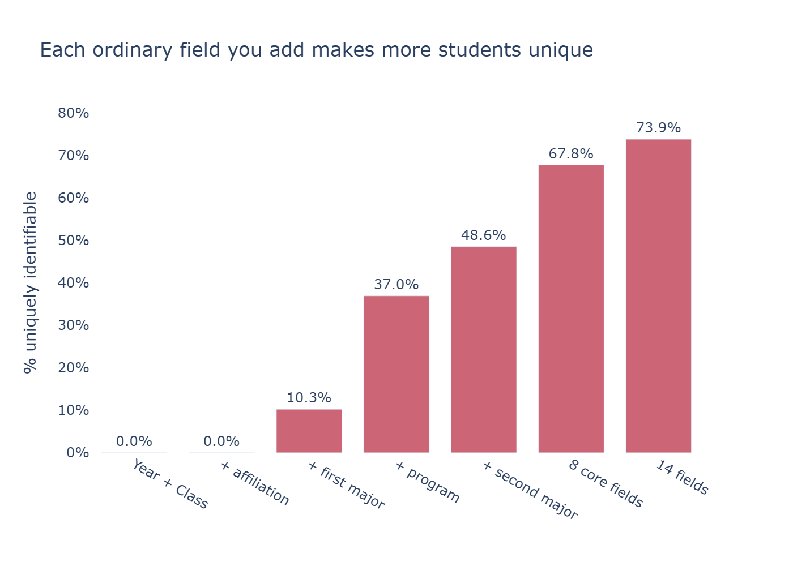
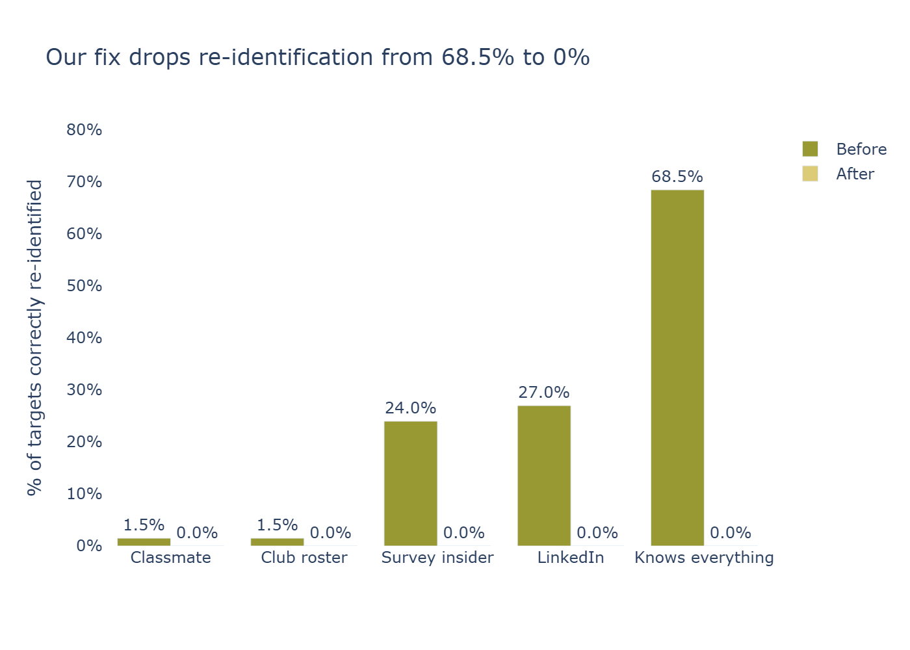
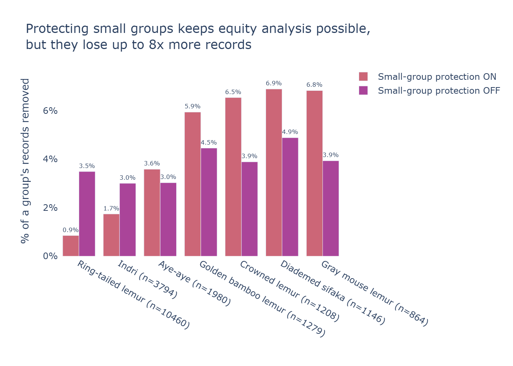

# Unmasked: Re-identification Risk Meter

> No names, no IDs, and still 68% of students can be singled out from eight ordinary survey fields
> (74% once prior-attendance flags are added, and 99.99% from all 14 fields plus survey timing).
> Unmasked finds that risk, fixes it, and shows what the fix costs, and who pays for it.

All results below come from BU's synthetic NSSE survey data (access-restricted, not included in this repo).
The app runs out of the box on generated demo data, with or without an LLM. See **Try it in 5 minutes**.

Built at BU Spark! DS+X × Hackachusetts 2026 for BU IS&T's Data Scrubbing / Tokenization challenge.

## Demo
[2-minute video](VIDEO_URL) · screenshots in `results/charts/`

## The problem
Removing names does not make data anonymous. Combinations of ordinary fields (year, class, program, major,
demographic group) single students out. FERPA asks whether a reasonable person in the school community could
identify a student with reasonable certainty, and ordinary survey fields clear that bar easily.

## What it does
1. An AI agent labels each column's privacy role using metadata only (names, types, counts, and computed
   metrics, never student rows).
2. Measures k-anonymity, uniqueness, the riskiest field combinations, metadata leaks, attacker personas,
   and a simulated linkage attack.
3. Tokenizes IDs (keyed HMAC tokens plus an encrypted vault with a separate key), removes direct identifiers,
   and scrubs free text with Microsoft Presidio.
4. Optimizes generalization and suppression to reach k ≥ 5 with ≤ 5% of records removed, optionally
   protecting small demographic groups.
5. Verifies with the attack, measures usefulness (group means and an ML utility test) and fairness, and writes
   a plain-English report plus a release privacy summary.

## Results (BU's synthetic NSSE data, 20,731 students)

| | Before | After (protect small groups) |
|---|---|---|
| Uniquely identifiable (8 ordinary fields) | 67.8% | 0% |
| Uniquely identifiable (14 fields) | 73.9% | 0% |
| Uniquely identifiable (all 14 fields + survey timing) | 99.99% | 0% |
| Linkage attack success (attacker knows all 9 core fields, 200 targets) | 68.5% | 0% |
| Records removed | – | 2.5% |
| ML utility, predicting engagement score (R²) | 0.42 | 0.37 |

The demo dataset is generated separately, so it gives similar but different numbers.


*Each ordinary field makes more students unique*


*Simulated linkage attack before and after*


*Who pays for privacy: records removed by group*

Survey timing is a strong but not standalone identifier: the survey date alone makes 11.7% of students unique
and the response duration alone 11.6%; combined with all 14 fields, uniqueness reaches 99.99%.

Smallest group size after mitigation is k = 5 (every combination of quasi-identifiers is shared by at least
five students). Without protecting small groups, the optimizer instead removes 3.5% of records and coarsens the
demographic column away entirely.

**Key finding (fairness):** privacy protection is not free, and it is not evenly paid. Without the small-group
safeguard, the optimizer generalizes the demographic (affiliation) column until equity analysis by that column
is impossible. With the safeguard on, the demographic column is preserved, but the smallest groups absorb the
cost: the most-affected group loses about 6.9% of its records versus about 0.85% for the largest group, roughly
an 8× gap. The tool measures and surfaces this rather than hiding it.

## PII detection on planted ground truth
Held-out planted sample (`results/detection.csv`, Presidio + spaCy `en_core_web_sm`). Emails, phones, and BU
IDs reach 1.00 precision and recall **on our planted test data**; names are harder:

| Entity | Precision | Recall |
|---|---|---|
| Email | 1.00 | 1.00 |
| Phone | 1.00 | 1.00 |
| BU ID | 1.00 | 1.00 |
| Person name | 1.00 | 0.91 |

Out-of-sample stress test (`results/detection_stress_test.csv`, 20 hand-written sentences): across the 20
sentences, person-name detection scores about 0.90 precision and 0.90 recall. The small spaCy model
misses some second names in a sentence (for example, a friend's full name introduced as a second subject) and
occasionally flags a campus place as a person, which is why names trail the near-perfect scores for structured
PII like emails and IDs.

## Data
The app supports three kinds of data:
- **BU synthetic NSSE (our results).** Provided by BU IS&T to hackathon participants behind a BU login, so we
  don't redistribute it. To reproduce our numbers, place `NSSE-synthetic.xlsx` and `lookup-synthetic.xlsx` in
  `data/` and run `python scripts/build_cache.py`.
- **Generated demo data (default without BU files).** `examples/demo_planted.csv` is entirely fake: same
  columns and conventions as the BU survey, random values, plus fake planted names, emails, IDs, and comments.
  Regenerate it with `python scripts/make_demo_data.py`.
- **Your own file.** Upload a CSV or XLSX in the app. Column roles are guessed from metadata (and the LLM, if
  configured); review them in tab 2 before measuring risk.

No real student data is used anywhere.

## Responsible AI and ethics
- The LLM sees only column metadata and computed metrics, never student rows. The one exception is an optional
  detection test that sends fully synthetic planted comments. Gemini is supported through an OpenAI-compatible
  endpoint; the whole pipeline also runs without any LLM (rule-based fallback), so the data science stands on
  its own.
- Keys and token vaults are stored separately and never committed. Tokenized data is pseudonymous, not
  anonymous: whoever holds the vault key can re-link it.
- We measure who loses data (fairness) and let data owners protect small demographic groups.
- A human data steward must review column roles and approve every release. This tool is **not** a FERPA
  compliance certificate.
- Limitations: k-anonymity does not prevent every inference about a group's answers (see l-diversity),
  real attackers may know more than our personas, and combining this release with others can re-identify
  people.

## Built with Kiro
We split the project into three specs so three people could build in parallel against shared interface
contracts. Specs live in `.kiro/specs/`, team-wide rules in `.kiro/steering/`.

- **`.kiro/specs/role-a-risk-engine`** (Role A): data loading and the risk engine, k-anonymity / uniqueness /
  riskiest-combination search, attacker personas, and the simulated linkage attack (`reid/load.py`,
  `reid/risk.py`, `reid/attacks.py`). Built through spec-driven development, with Kiro also used for acceptance
  checks, debugging, data comparisons, and merges.
- **`.kiro/specs/role-b-mitigation`** (Role B): PII planting, Presidio text scrubbing, HMAC tokenization with an
  encrypted vault, the generalization/suppression optimizer, and the utility and fairness measures
  (`reid/plant.py`, `reid/pii_text.py`, `reid/tokens.py`, `reid/mitigate.py`, `reid/utility.py`). Also built
  spec-first, with Kiro used for acceptance checks, debugging, data comparisons, and merges.
- **`.kiro/specs/role-c-agent-app`** (Role C): the AI agent that orchestrates measure → plan → act → verify →
  report, the metadata-only LLM wrapper and column classifier, and the six-tab Streamlit app
  (`reid/agent.py`, `reid/llm.py`, `reid/classify.py`, `app.py`). Here the spec documents the agent and app
  rather than generating them; Kiro was used for the Gemini integration, the LLM diagnostic script, the
  release-warning feature, README and submission drafting, merges, and troubleshooting.

Shared steering files (`.kiro/steering/product.md`, `structure.md`, `tech.md`) kept everyone to the same file
ownership, naming conventions, and safety rules (for example: never send rows to the LLM; never commit data or
keys).

## Try it in 5 minutes (no BU data or LLM needed)
Requires **Python 3.11 or 3.12** (some dependencies don't support 3.14 yet).

**Windows (PowerShell)**, one command per line:
```powershell
git clone https://github.com/williamwang2029-cloud/unmasked.git
cd unmasked
py -3.12 -m venv .venv      # or: py -3.11 -m venv .venv (check with: py -0p)
.\.venv\Scripts\Activate.ps1
pip install -r requirements.txt
python -m spacy download en_core_web_sm
streamlit run app.py
```
If PowerShell blocks the activation script, run `Set-ExecutionPolicy -Scope CurrentUser RemoteSigned` once.

**Mac/Linux:**
```bash
git clone https://github.com/williamwang2029-cloud/unmasked.git
cd unmasked
python3.12 -m venv .venv && source .venv/bin/activate   # or python3.11
pip install -r requirements.txt
python -m spacy download en_core_web_sm
streamlit run app.py
```
The app opens at http://localhost:8501 on the generated demo data, in rule-based mode unless you set up an LLM
(below). The sidebar shows which mode is active. Press Ctrl+C in the terminal to stop it.

### Using the app
1. **Data:** preview the dataset (demo, BU, or your upload).
2. **Column roles:** the agent labels each column (identifier, quasi-identifier, metadata, sensitive...);
   review and override, then confirm.
3. **Risk:** how many students are unique, the riskiest field pairs, attacker personas, and risk by
   demographic group.
4. **Fix it:** choose k, the maximum share of records to remove, and whether to protect small groups, then run
   the privacy agent.
5. **Before vs. after:** the release privacy summary, the attack before and after, who lost records, and which
   analyses still work.
6. **Report & download:** the plain-English report (labeled as LLM-written or rule-based) and the protected
   dataset.

### Reproducing our results (BU data required)
```bash
python scripts/build_cache.py
python scripts/run_experiments.py --skip-presidio   # about a minute
python scripts/run_experiments.py                   # adds PII detection, several minutes
python scripts/check_numbers.py                     # confirms the headline numbers
```
`results/` is already included, so this is only needed to regenerate it.

### Checks
- `python scripts/smoke_test.py`: end-to-end agent run (uses BU data if present, otherwise the demo data)
- `python scripts/checks/test_release_warnings.py`: no data needed
- `python scripts/check_llm.py`: tests the optional LLM connection

### LLM (optional)

The app works **fully without an LLM** (rule-based mode). With a key, the agent writes nicer plans, reports,
and column-role explanations. Risk, mitigation, and attacks are identical either way. The LLM sees only column
metadata and computed metrics, never student rows (the one exception is an optional detection test that sends
fully synthetic planted comments).

To enable it, create a `.env` from the template — Windows: `copy .env.example .env`; Mac/Linux:
`cp .env.example .env` — then set these (Google's Gemini is free via AI Studio and works through the
OpenAI-compatible endpoint):

```env
LLM_PROVIDER=openai
LLM_MODEL=gemini-2.0-flash   # any model name from Google AI Studio
OPENAI_API_KEY=your-ai-studio-key
OPENAI_BASE_URL=https://generativelanguage.googleapis.com/v1beta/openai/
```

Omit `OPENAI_BASE_URL` to use OpenAI directly, or set `LLM_PROVIDER=anthropic` with `ANTHROPIC_API_KEY`. The
app sidebar shows the current mode: **"LLM connected"** (with the model name), **"LLM configured but not
responding"** (key set but the call failed — the app uses rule-based mode), or **"No LLM: rule-based mode"**.
Use the sidebar's "Recheck LLM connection" button after changing `.env`.

Troubleshooting: run `python scripts/check_llm.py` to make one live test call. It prints the resolved config
(API key masked), reports whether the LLM is enabled, and either shows the model's reply or the exact error, so
you can tell a key/model problem apart from a connection problem.

## Team
- **Kieran McBride** (Role A) — risk engine and attacks: data loading, k-anonymity/uniqueness, riskiest-combination
  search, attacker personas, and the simulated linkage attack.
- **Kealoha Comcowich** (Role B) — mitigation and evaluation: PII planting, Presidio text scrubbing, HMAC tokenization
  with an encrypted vault, the generalization/suppression optimizer, and the utility and fairness measures.
- **William Wang** (Role C) — agent and app: the privacy agent orchestration, the metadata-only LLM wrapper and
  column classifier, and the six-tab Streamlit app.

## Credits
BU IS&T (challenge and synthetic data), NSSE codebooks, Microsoft Presidio, spaCy, Faker, scikit-learn,
Streamlit, Plotly, and Kiro.
